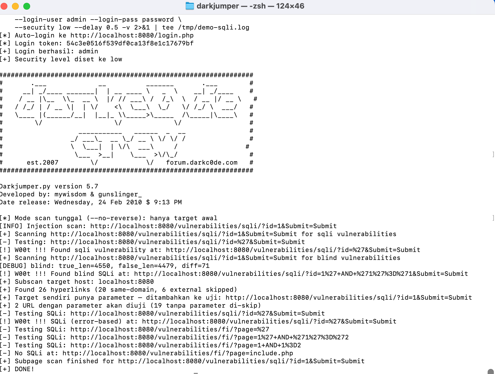

# Darkjumper v5.7 — Professional + AI

Web Vulnerability Scanner dengan **AI verification**, **SQLi/LFI detection**,
**auto-login**, **sqlmap integration**, dan **output SARIF** untuk CI/CD.

> **Peringatan:** Gunakan **hanya** pada sistem yang kamu miliki atau punya izin tertulis.

---

## Demo



---


---

## Fitur

### 13 Mode Scanning

| Mode | Fungsi | Risiko |
|---|---|---|
| `reverseonly` | Cari domain lain di IP yang sama (HackerTarget + RapidDNS) | Rendah |
| `headerinfo` | Lihat HTTP headers | Rendah |
| `checkip` | Cek IP publik & ISP | Rendah |
| `converter` | Encode hex/base64 | Rendah |
| `portscan` | Scan port terbuka | Sedang |
| `daemoninfo` | Banner grab port umum | Sedang |
| `scanadminpath` | Cari panel admin | Rendah |
| `cgidirs` | Cari path CGI | Rendah |
| `ftpanon` | Cek login anonim FTP | Sedang |
| `injection` | Deteksi SQLi (error-based + blind) | Tinggi |
| `inclusion` | Deteksi LFI / RFI / RCE | Tinggi |
| `full` | Injection + Inclusion | Tinggi |
| `enum` | Enumerasi user + auto-bruteforce FTP | Tinggi |

### Fitur Profesional

- **Arsitektur `core/`** — logger, http_client, findings, scanner, ai_verifier
- **AI verification** — Groq, DeepSeek, OpenAI, Ollama (filter false positive)
- **Output** — JSON, CSV, SARIF (CI/CD ready)
- **WAF detection** — Cloudflare, Sucuri, ModSecurity, AWS WAF, Akamai, Imperva
- **Tech detection** — WordPress, Laravel, Django, Rails, JSP, ASP.NET, PHP
- **Auto-login** — CSRF token (DVWA v1.10)
- **sqlmap integration** — deteksi lalu dump database
- **Validasi target** — DNS resolution sebelum scan
- **Rate limiting** — `--delay` global
- **Thread-safe findings** — lock untuk multi-thread
- **Retry** — 3x backoff untuk request gagal

---

## Instalasi

```bash
pip install requests beautifulsoup4

# macOS
brew install sqlmap

# atau via git
git clone https://github.com/sqlmapproject/sqlmap.git ~/tools/sqlmap-dev

Opsi CLI
Opsi	Keterangan
-t, --target	Target hostname atau IP
-m, --mode	Mode scanning (wajib)
-p, --proxy	Proxy
-v, --verbose	Tampilkan detail
-a, --autobrute	Auto-bruteforce FTP
-r, --port-range	Range port untuk portscan
--no-reverse	Paksa scan tunggal
--reverse	Paksa reverse IP
--exploit {detect,dbs,tables,columns,dump,users,passwords}	Level eksploitasi sqlmap
--i-have-permission	Konfirmasi izin untuk dump/users/passwords
--delay SECONDS	Rate limiting
--login-url	URL login untuk auto-login
--login-user	Username auto-login
--login-pass	Password auto-login
--security {low,medium,high}	Security level DVWA
--ai-verify	Aktifkan AI verification
--ai-provider {deepseek,groq,openai,ollama}	Provider AI
--ai-model	Model AI
--ai-base-url	Base URL untuk Ollama

Cara Pakai
Recon Passif

python3 darkjumper.py -t example.com -m headerinfo --no-reverse -v
python3 darkjumper.py -t example.com -m checkip -v
python3 darkjumper.py -t example.com -m converter

Port & Service
bash
python3 darkjumper.py -t scanme.nmap.org -m portscan -r 20-100 --no-reverse -v
python3 darkjumper.py -t scanme.nmap.org -m daemoninfo --no-reverse -v

Panel Admin & CGI
bash
python3 darkjumper.py -t example.com -m scanadminpath --no-reverse -v
python3 darkjumper.py -t example.com -m cgidirs --no-reverse -v

Reverse IP
bash
python3 darkjumper.py -t example.com -m reverseonly -v

SQLi Detection (DVWA)
bash
# Low — error-based + blind
python3 darkjumper.py -t "localhost:8080/vulnerabilities/sqli/?id=1&Submit=Submit" -m injection --no-reverse \
    --login-url http://localhost:8080/login.php \
    --login-user admin --login-pass password \
    --security low --delay 0.5 -v

# Medium — blind only
python3 darkjumper.py -t "localhost:8080/vulnerabilities/sqli/?id=1&Submit=Submit" -m injection --no-reverse \
    --login-url http://localhost:8080/login.php \
    --login-user admin --login-pass password \
    --security medium --delay 0.5 -v

LFI Detection (DVWA)
bash
python3 darkjumper.py -t "localhost:8080/vulnerabilities/fi/?page=1" -m inclusion --no-reverse \
    --login-url http://localhost:8080/login.php \
    --login-user admin --login-pass password \
    --security medium --delay 0.5 -v

Eksploitasi sqlmap
bash
python3 darkjumper.py -t "localhost:8080/vulnerabilities/sqli/?id=1&Submit=Submit" -m injection --no-reverse \
    --login-url http://localhost:8080/login.php \
    --login-user admin --login-pass password \
    --exploit dbs --i-have-permission --delay 0.5 -v
AI Verification
bash
# Groq (gratis)
export DARKJUMPER_AI_KEY="gsk_..."
python3 darkjumper.py -t "target" -m injection --no-reverse \
    --ai-verify --ai-provider groq --ai-model openai/gpt-oss-20b -v

# DeepSeek 
export DARKJUMPER_AI_KEY="sk-..."
python3 darkjumper.py -t "target" -m injection --no-reverse \
    --ai-verify --ai-provider deepseek --ai-model deepseek-chat -v

# Ollama (offline)
ollama pull qwen2.5-coder:0.5b
python3 darkjumper.py -t "target" -m injection --no-reverse \
    --ai-verify --ai-provider ollama --ai-model qwen2.5-coder:0.5b \
    --ai-base-url http://localhost:11434/v1 -v

Batasan
HackerTarget — 50 query/hari

sqlmap — butuh URL dengan parameter asli (?id=1)

DVWA — RFI/RCE tidak rentan di v1.10 Low/Medium

WordPress — ?p= tidak rentan SQLi, gunakan wpscan

Rate limit — gunakan --delay 0.5 untuk production

AI provider — Groq gratis, DeepSeek murah, Ollama offline

Peringatan Hukum
Gunakan hanya pada sistem yang kamu miliki atau punya izin tertulis

Mode injection, inclusion, full, enum, ftpanon mengirim payload berbahaya

--exploit dump/users/passwords butuh --i-have-permission

Data hasil dump wajib dihapus setelah audit

Selalu backup sebelum tes ke production

Lisensi
Proyek ini untuk tujuan edukasi dan audit keamanan yang sah.

Kontributor
Original: mywisdom & gunslinger_ (2007–2010)

Update by ABUI (2026)
